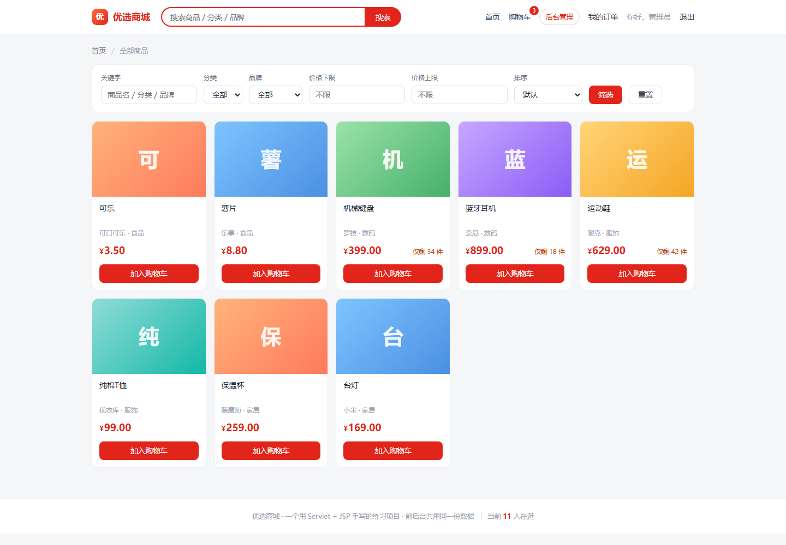
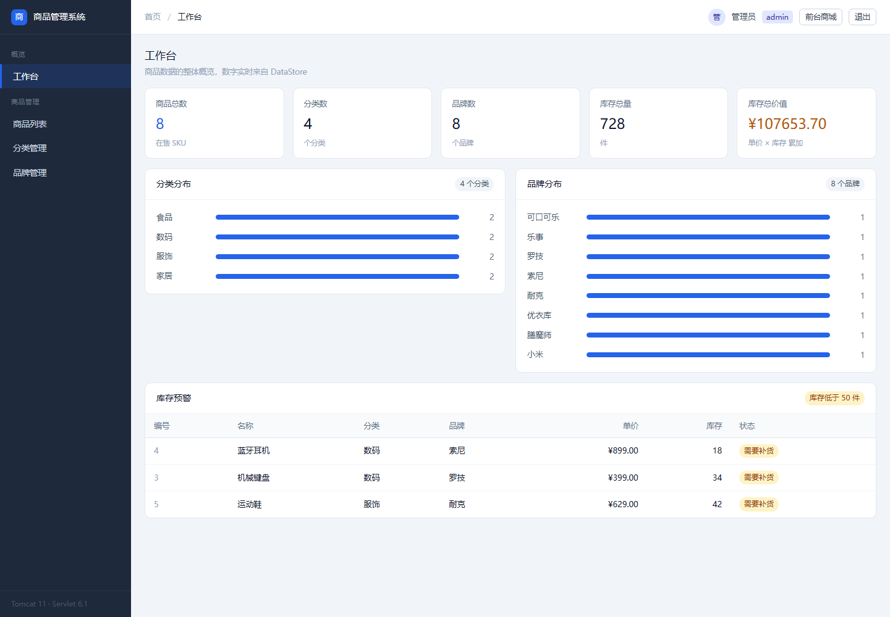
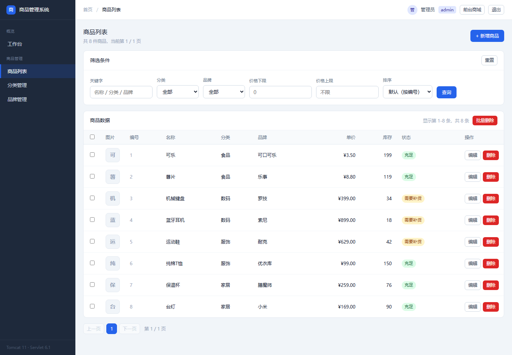
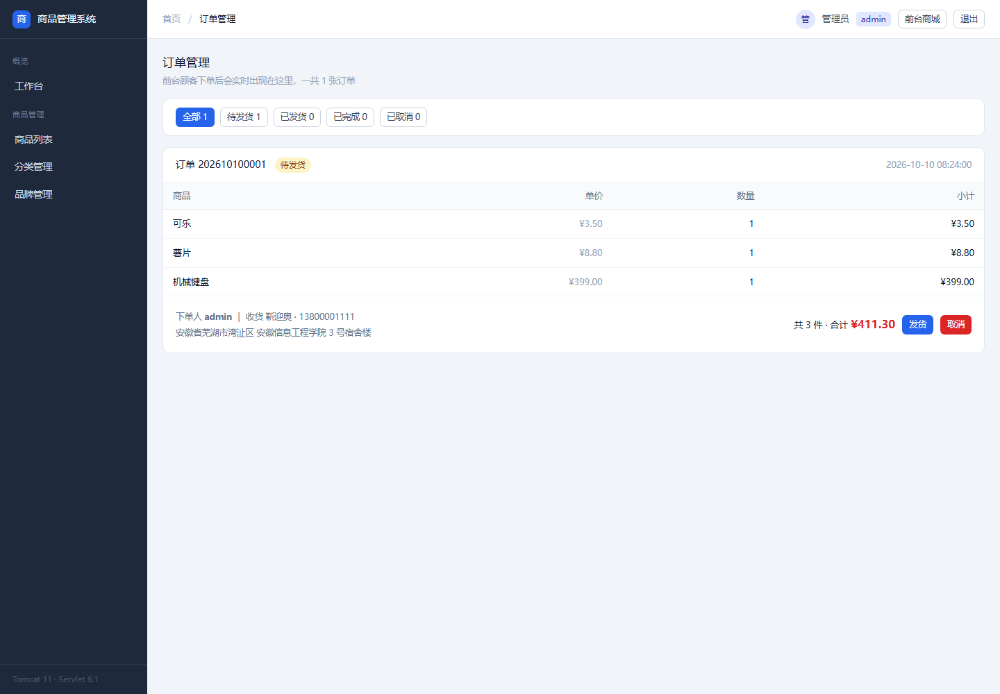
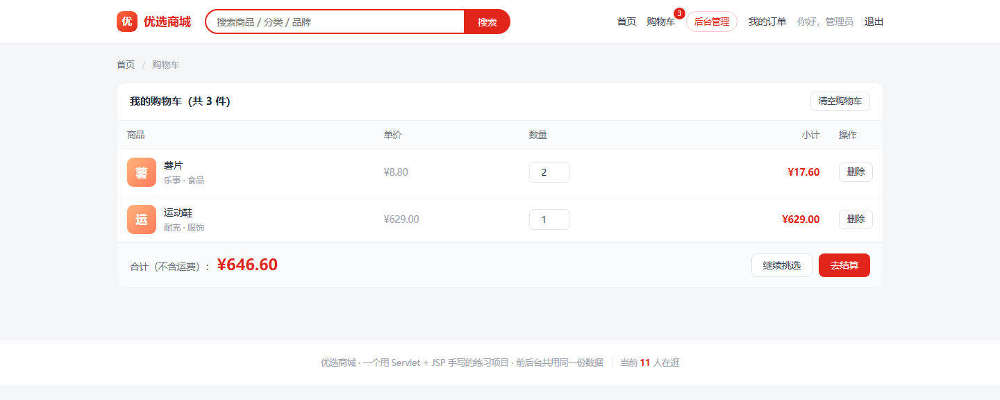

# 商品管理系统（小蓝鲸电商项目）

Java Web 课程项目：一套 **后台管理系统 + 前台商城**。
后台负责维护商品、分类、品牌和处理订单；前台给顾客浏览、加购、下单。两边共用同一份数据。

> Servlet + JSP + 手写 JDBC 思路的数据层，不依赖 Spring。



---

## 技术栈

| 层次 | 选型 |
|---|---|
| 语言 / 编译 | Java 17、Maven |
| Web 层 | Jakarta Servlet 6.1（`@WebServlet` 注解式）、JSP + JSTL |
| 容器 | Apache Tomcat 11 |
| 数据层 | `DataStore` 单例（内存 + 读写锁），商品图片外置到 war 目录外 |
| 前端 | 原生 CSS（`mall.css`），无框架 |

## 功能

**后台管理**

- 登录 / 退出，基于 **RBAC** 的双角色：`admin` 全部权限、`user` 只读
- 工作台：商品数、分类数、品牌数、订单数统计，库存预警
- 商品管理：分页、按价格 / 库存排序、关键字 + 分类 + 品牌组合筛选、新增 / 编辑 / 删除、图片上传
- 分类 / 品牌管理：增删改；删除前校验是否被商品引用；「其他」品牌为哨兵数据不可删
- 订单管理：查看全部订单与明细，状态流转（待发货 → 已发货 → 已完成）与取消
- 越权访问返回 403 页面

**前台商城**

- 商品列表：搜索、分类 / 品牌筛选、排序
- 商品详情、加入购物车
- 购物车：改数量、移除、合计
- 结算下单：校验并扣减库存、清空购物车
- 我的订单：只显示自己的订单（防水平越权）

## 页面

| 后台工作台 | 商品列表 |
|---|---|
|  |  |

| 订单管理 | 购物车 |
|---|---|
|  |  |

## 目录结构

```
src/main/java/com/cn/
├── Brand.java  Category.java  Product 相关…      ← 12 个模型类
└── web/
    ├── LoginServlet / LogoutServlet              ← 登录
    ├── DashboardServlet                          ← 工作台
    ├── ProductListServlet / ProductFormServlet / ProductDeleteServlet
    ├── CategoryServlet / BrandServlet            ← 分类、品牌
    ├── AdminOrderServlet / OrderServlet          ← 后台订单 / 前台订单
    ├── MallServlet / MallItemServlet / CartServlet ← 前台商城
    ├── AuthFilter                                ← 权限过滤
    ├── DataStore                                 ← 业务与数据层
    └── Params / Page / Flash / Stat / Uploads    ← 工具类

src/main/webapp/
├── WEB-INF/views/          ← 后台页面（含 common/ 公共片段）
├── WEB-INF/views/mall/     ← 前台页面
├── css/  js/
└── index.jsp
```

## 运行

```bash
# 1. 打包
mvn clean package

# 2. 部署（war 重命名为 shop.war 后丢进 Tomcat）
cp target/shop.war $CATALINA_HOME/webapps/

# 3. 启动 Tomcat 后访问
#    前台商城 http://localhost:8080/shop/
#    后台管理 http://localhost:8080/shop/login
```

**测试账号**

| 账号 | 密码 | 权限 |
|---|---|---|
| `admin` | `123456` | 全部功能 |
| `user` | `123456` | 只读 + 列表 + 排序 |

## 其他

- `_apifox/` —— 用 Node 脚本生成 Apifox / Postman 可直接导入的接口集合（52 个接口、全部带断言），以及回放校验脚本
- `*回归测试.ps1` —— 品牌、图片、监听器、前台接口的回归脚本
- `商品管理系统-Servlet版-学习笔记.md` —— 开发过程中的踩坑记录与设计说明
